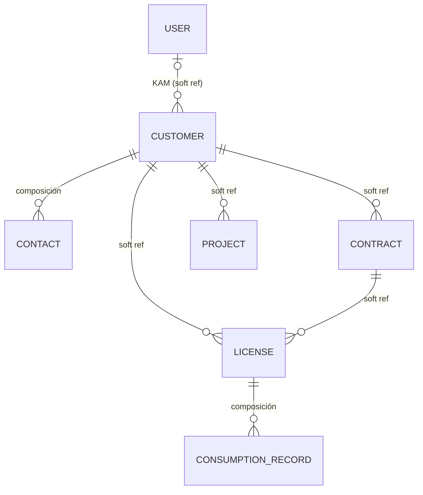
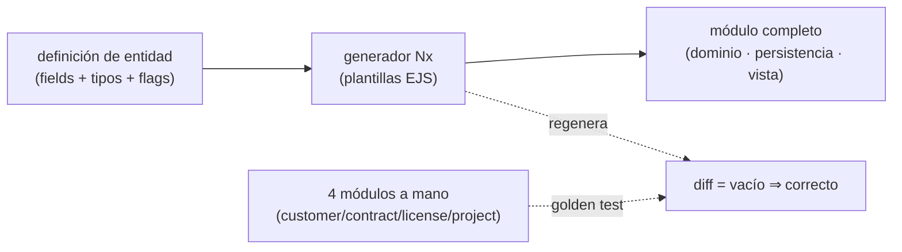
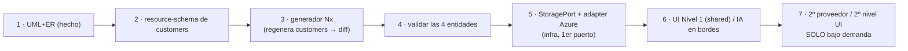

# Acelerador de Dashboards — Arquitectura consolidada

**Fecha:** 2026-07-10
**Estado:** Brainstorming cerrado, listo para pasar a spec
**Caso de referencia:** `sap-licences` (Angular + NestJS · Nx · DDD)
**Autor:** Alfonso Domínguez

> Documento maestro. Consolida y **supera** los borradores previos, resolviendo la deriva del debate (empezó explorando un RAG por imagen y aterrizó en un generador determinista). Refleja el diseño **final**. Los documentos fuente quedan como detalle (§11), marcados como vigentes o superados.

---

## 1. Resumen ejecutivo

El acelerador genera dashboards de negocio (tablas paginadas con filtros/orden/búsqueda + CRUD + export + módulos transversales) de forma rápida y repetible, entregables a distintos clientes con distinta piel y distinta infra.

La conclusión del diseño, tras descartar caminos más vistosos, es deliberadamente **aburrida y sólida**:

- Un **esqueleto tested** (lo que ya existe en `sap-licences`) como base estable.
- Un **generador Nx determinista** que, a partir de una **definición de entidad**, emite el código base de un módulo completo (dominio + persistencia + vista). Sin IA en el núcleo.
- La **IA en los bordes** (opcional): ayuda a redactar el modelo y a rellenar huecos de negocio marcados, siempre bajo un gate de verificación determinista.
- **Adapters seleccionables** (mismo patrón para UI e infra): puertos estables + catálogo almacenado + composition root generado, para cambiar librería de componentes o proveedor cloud por cliente.

El principio transversal a todo: **estructura determinista en el centro, variabilidad en los bordes, verificación en la frontera.**

---

## 1.bis. El marco hexagonal (lente unificadora)

Todo lo que sigue se ordena bajo una sola idea: **el acelerador es un hexágono con los dos lados de puertos abiertos.** La arquitectura hexagonal deja abstractos a propósito el lado por el que se **conduce** la app (primario/driving) y el lado de lo que la app **necesita** (secundario/driven). El acelerador aporta el hexágono (espina ports & adapters + kernel) y deja que cada proyecto rellene los adapters concretos de ambos lados.

```
     PRIMARY / driving  (cómo se conduce la app — el contrato que EXPONE)
     REST · GraphQL · gRPC · UI dashboard · contrato CMIS
                    │  primary adapters
                    ▼
        ┌─────────────────────────────┐
        │  CORE (hexágono)            │   ← el acelerador: espina + kernel;
        │  puertos + dominio          │      el arquetipo (ADR-007) marca
        │  (grado según arquetipo)    │      cuánto dominio hay
        └─────────────────────────────┘
                    │  secondary adapters
                    ▼
     SECONDARY / driven  (lo que la app NECESITA)
     BD · API externa (OpenText) · storage · auth · tenant
```

Cada ADR cuelga de un lado del hexágono:

- **Lado primario (driving):** desacoplamiento de UI (ADR-003, un adapter primario); autorización en el borde conductor (ADR-006, guards). El arquetipo decide el adapter primario: UI en `ddd-fullstack`, contrato REST/CMIS en `bridge-api`.
- **Lado secundario (driven):** persistencia (ADR-002), infra/storage (ADR-004), `TenantContext` (ADR-005), adapter sobre sistema externo (`cmis-api`). El arquetipo (ADR-007) se distingue sobre todo por **qué envuelve este lado**: BD, API externa o nada.

Hasta la **entrada del generador** encaja: en `ddd-fullstack` la entidad describe a la vez el contrato primario (API CRUD) y el puerto secundario (persistencia); en `bridge-api` la entrada describe el **puerto primario** (los endpoints expuestos), porque el secundario es un adapter fijo sobre el sistema externo. Los perfiles difieren en **qué lado del hexágono describe la entrada**.

**Contrapeso (regla de los dos).** No conocer el adapter _concreto_ está bien; no conocer el _conjunto_ de adapters previstos, no. Un puerto solo se diseña bien contra un conjunto real de implementaciones (mínimo común denominador). **Un puerto se gana su sitio en el segundo o tercer adapter real**, no en el primero: con uno solo, adapter directo; el puerto se extrae cuando aparece el segundo. Igual en el lado primario: hoy REST; no abstraer para GraphQL/gRPC hasta que un proyecto lo pida.

---

## 2. El problema y por qué es abordable

Los dashboards comparten muchísimo: tablas con paginación/filtro/búsqueda/orden, CRUD, subida/descarga de ficheros, auth multi-tenant. Y cambian en tres ejes por cliente: **el modelo de datos**, **la piel** (librería de componentes) y **la infraestructura** (Azure/AWS/GCP/Cloudflare).

La observación que lo hace tratable, verificada en el código: cada vista parece un dato aislado pero por debajo comparte un **grafo de dominio** con raíz en `Customer`, y cada módulo (`customers`, `contracts`, `licenses`, `projects`) tiene la **misma forma** con distinto **binding**. Esa dualidad **estructura ↔ binding** es la que se explota en todo el diseño.

---

## 3. Decisión de enfoque (y qué se descartó)

**Elegido: generación determinista schema-driven.** Una definición de entidad → plantillas Nx → código real, editable, tuyo. Reproducible, offline, sin coste por ejecución.

**Explorado y descartado: RAG por imagen.** La idea inicial —almacenar pares (captura, código) e indexar por similitud visual para recuperar y re-ligar— se estudió a fondo (ver §11, doc marcado _superado_). Se descartó porque: (a) su valor marginal sobre un buen generador es bajo; (b) depende fuertemente de IA, justo lo que se quería minimizar; (c) para cuando el corpus estuviera listo, un LLM genérico haría lo mismo sin él. Llevada a su conclusión lógica, **convergía en la generación schema-driven** — así que se fue directo al destino.

Lo que la exploración del RAG dejó y sí se conserva: el split **estructura/binding**, el **UML/ER como fuente**, y el **contrato de conformidad** de las piezas.

---

## 4. El modelo de dominio (la fuente)

Dos vistas complementarias, extraídas del código real.

**UML de clases (comportamiento).** Los agregados (`Customer`, `Contract`, `License`, `Project`) comparten un **protocolo común** —`create` / `fromPrimitives` / `toPrimitives` / `updateDetails` / `equals`— y añaden sus Value Objects (con `create()` validador) y métodos de unicidad. El protocolo es **estructura**; los VOs y sus invariantes, **binding**.

**ER (datos y conexiones).** Todo cuelga de `Customer`, con relaciones **por referencia de ID** (DDD, sin FK dura entre contextos):



Dos tipos de arista que el generador trata distinto: **composición** (hijo propio, cascada) y **referencia entre contextos** (solo ID + lookup). Detalle: `uml-clases-dominio.md`, `uml-modelo-dominio.md`.

---

## 5. El resource-schema (la proyección)

Entre el modelo de dominio y el generador está el **resource-schema**: una proyección por vista de la que salen **a la vez** el front y el back. Cada campo declara su VO+constraints, su `query` (filtrable/ordenable/buscable), su `table` (columna+ancho) y su `form` (control). Esto **elimina de raíz** la coherencia manual front↔back que hoy se mantiene por comentario.

Verificado: el schema de `customers` reproduce el módulo actual campo a campo (ver `resource-schema-customers.md`, §4 de fidelidad).

Principio: **generar, no interpretar.** El schema cubre el caso canónico; lo raro se edita a mano sobre el código generado. Nunca se retuerce el schema para modelarlo todo (evita el _inner-platform effect_).

---

## 6. El generador Nx (el mecanismo)

Determinista: lee la definición de entidad, calcula sustituciones y expande plantillas EJS. Las plantillas no mencionan ninguna entidad concreta; tienen huecos.



**Validación por referencias de oro:** generar los 4 módulos ya escritos a mano y comparar por `diff`. Diff vacío ⇒ el generador es correcto y generaliza. Es un test, no una impresión.

**Coherencia gratis:** `columns[]` (front) y `ALLOWED_FILTERS/ORDERS` (back) salen del mismo array `fields` → imposible desincronizarlos.

**Regla que decide todo:** plantillas tontas, lógica en `generator.ts`. Detalle: `guia-generador-nx.md`.

---

## 7. La IA en los bordes (opcional)

El generador no depende de la IA. Ésta interviene solo donde el determinismo no llega, y siempre bajo verificación:

- **① Pre-generación:** la IA redacta el _modelo_ (no el código) desde lenguaje natural / SQL / captura. Salida pequeña, revisable; el código lo produce la plantilla.
- **② Post-generación:** la IA rellena **huecos marcados** (`// @ai:begin … @ai:end`): validación de negocio, métodos específicos, tests de casos límite, seed. Radio de acción acotado a los marcadores.
- **Gate determinista:** nada se acepta sin compilar + pasar `enforce-module-boundaries` + tests + diff de oro. **Se confía en el gate, no en la IA.**

Integración recomendada: IA **alrededor** del generador (pasos separados y opcionales), no dentro del núcleo. Detalle: `integracion-ia-generador.md`.

---

## 8. Los ejes de decisión (ADRs)

**Decisión de nivel 0 — arquetipo de arquitectura (ADR-007).** Se elige _primero_, según el problema: `ddd-fullstack` (dominio rico + BD + UI, ref. `sap-licences`) o `bridge-api` (proxy/traducción a sistema externo, sin BD ni UI, ref. `ip-opentext-cmis-api`). Hallazgo: ambos comparten la **misma espina ports & adapters**; solo varían el grado de dominio, qué envuelven los adapters (BD vs API externa) y la entrada del generador. El kernel se reutiliza; el arquetipo decide la forma. Determina todo lo de abajo.

Sobre ese arquetipo, un mismo patrón —**puerto + catálogo de adapters + composition root generado**— resuelve los ejes de desacoplamiento:

- **Datos (ADR-002):** denormalización por defecto en listados CRUD (lectura de una tabla); JOIN/read-model solo para reporting a mano; composición cargable dentro del agregado. Mantiene el generador simple.
- **UI (ADR-003):** desacoplamiento por capas. _Nivel 1_ (ahora): plantillas emiten contra componentes shared → cambiar piel = shared + regenerar. _Nivel 2_ (bajo demanda): contratos headless + adapters, cambio sin regenerar. La tabla ya está desacoplada (`data-table`); faltan diálogos/botones. Regla de lint: prohibir `@spartan-ng/*` en features.
- **Infra (ADR-004):** puertos (`StoragePort`, `AuthPort`…) + catálogo de adapters por referencia + composition root con `.env` y Terraform. Runtime por env (12-factor). Ranking de ROI: storage y Postgres fáciles; identidad vía OIDC; **cómputo muy difícil (Cloudflare Workers ≠ contenedor Node)**. Test de conformidad por puerto obligatorio.

Y dos ejes más, de perfil por app:

- **Tenancy (ADR-005):** dos perfiles seleccionables al crear la app — _single-tenant_ (sin `tenant_id`, user/admin simple) y _multi-tenant pooled_ (`tenant_id` + RLS). Puerto `TenantContext` siempre presente; el dominio es agnóstico. Es perfil de generación (toca el esquema), no de runtime. Hedge "build for multi, run as single" si el cliente puede crecer.
- **Autorización (ADR-006):** RBAC con permisos `recurso:acción` agrupados en roles; checks por permiso, no por rol; scoping por propiedad (ABAC ligero) solo donde el dominio lo pida (`customer↔KAM`). Los permisos base los deriva el generador del schema.

Base de capas y desacoplamiento general: ADR-001.

---

## 9. Secuencia de construcción (por riesgo)



Profundidad antes que anchura: **un recurso perfecto** antes que muchos a medias. Parar en el paso 3-4 hasta que ahorre horas medibles.

---

## 10. Riesgos y probabilidad (honesto)

- **Núcleo (esqueleto + schema + generador): ~70-80%.** Camino probado; el riesgo es la cola larga del 20% no canónico → mitigado con "generar y poseer".
- **Adapters UI/infra intercambiables: ~50%, dependiente de demanda.** Riesgo de abstracción con fugas → puertos por mínimo común denominador + test de conformidad. **No construir especulativamente.**
- **IA en bordes: bajo riesgo** por estar contenida en el gate.
- **El riesgo que domina no es técnico:** trabajas en solitario; mantener un meta-framework en paralelo a entregar clientes es donde estas iniciativas mueren. Mitigación: tratar el acelerador como **subproducto** de proyectos reales, no como proyecto aparte.

Regla de oro del proyecto: construir la versión aburrida primero y dejar que **las horas ahorradas** decidan si las capas de arriba merecen existir.

---

## 11. Índice de documentos fuente

| Documento                                         | Rol                                                  | Estado                               |
| ------------------------------------------------- | ---------------------------------------------------- | ------------------------------------ |
| **ACELERADOR-arquitectura-consolidada.md**        | Este maestro                                         | Vigente                              |
| `arquitectura-acelerador-dashboards.md` (ADR-001) | Capas, backend genérico, multi-tenant                | Vigente                              |
| `ADR-002-denormalizacion-vs-join.md`              | Decisión de acceso a datos                           | Vigente                              |
| `ADR-003-desacoplamiento-ui.md`                   | Desacoplamiento de librería UI                       | Vigente                              |
| `ADR-004-portabilidad-infra-catalogo-adapters.md` | Portabilidad de infra + catálogo                     | Vigente                              |
| `ADR-005-tenancy-perfil-seleccionable.md`         | Tenancy: single / multi-pooled + RLS                 | Vigente                              |
| `ADR-006-modelo-autorizacion.md`                  | Autorización: RBAC con permisos + ABAC ligero        | Vigente                              |
| `ADR-007-arquetipos-arquitectura.md`              | Arquetipos: ddd-fullstack / bridge-api, espina común | Vigente                              |
| `uml-clases-dominio.md`                           | UML de clases (comportamiento)                       | Vigente                              |
| `uml-modelo-dominio.md`                           | ER (datos y relaciones)                              | Vigente                              |
| `resource-schema-customers.md`                    | Proyección + fidelidad                               | Vigente                              |
| `guia-generador-nx.md`                            | Mecanismo del generador                              | Vigente                              |
| `integracion-ia-generador.md`                     | IA en los bordes                                     | Vigente                              |
| `contrato-unidad-vista-rag.md`                    | Anatomía de la unidad-vista                          | Vigente (concepto), **RAG superado** |
| `dossier-acelerador-dashboards.md`                | Dossier previo                                       | **Superado por este**                |

> El `contrato-unidad-vista-rag.md` conserva valor por la anatomía estructura/binding de un módulo; su marco de recuperación por imagen queda superado por el generador determinista.

---

## 12. Siguiente paso

Cerrar las 5 decisiones abiertas del resource-schema (`resource-schema-customers.md` §5) y pasar a `/spec-new`: feature **"generador de recurso"**, cuya primera tarea (guía §9, pasos 1-2) es el plugin Nx vacío + generar la entidad TypeORM de `contract`, validada por diff. TDD y tareas atómicas según el flujo del proyecto.
