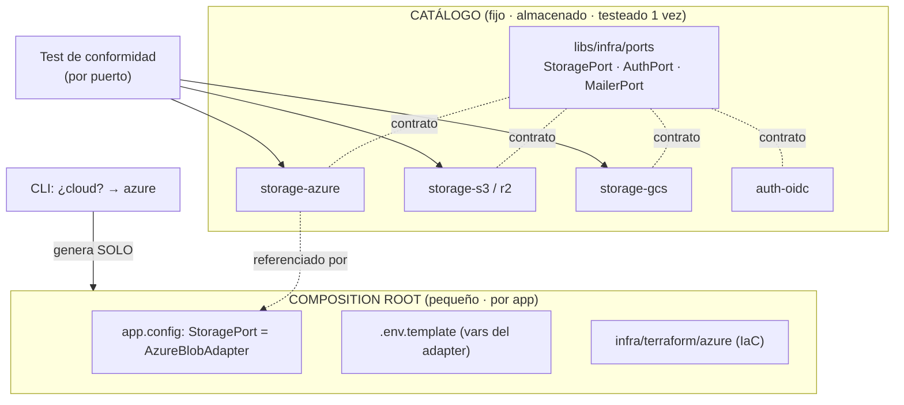

# ADR-004: Portabilidad de infra y catálogo de adapters

**Estado:** Propuesto
**Fecha:** 2026-07-10
**Autor:** Alfonso Domínguez
**Relacionado:** ADR-001 (arquitectura), ADR-003 (desacoplamiento UI), `guia-generador-nx.md`, `integracion-ia-generador.md`

---

## 1. Contexto

La infraestructura **cambia por cliente**: unos usan Azure (mayoritario), otros AWS, Google o Cloudflare. El acelerador debe poder desplegarse contra el proveedor de cada cliente sin reescribir la app.

El proyecto ya es hexagonal: define **puertos** en el dominio (repositorios, `sap-for-me-gateway`) implementados en `infrastructure`. La idea es extender ese patrón a la infra y, sobre todo, **almacenar los adapters una vez** para **proveerlos según la decisión tomada al crear la app** — no generarlos cada vez.

Esto unifica un patrón que ya aparece en tres sitios: UI (ADR-003 Nivel 2), infra (este ADR) y, en general, cualquier dependencia externa. Todos son **puertos + catálogo de adapters seleccionables**.

---

## 2. Decisión

Adoptar un **catálogo de adapters** con selección en el momento de crear/configurar la app:

1. **Puertos estables** (interfaces) por cada concern de infra: `StoragePort`, `AuthPort`, `MailerPort`, `SecretsPort`, `QueuePort`…
2. **Catálogo de adapters almacenados** (una `lib` por adapter), escritos y testeados **una sola vez**, implementando esos puertos.
3. **Composition root generado** por app: lo único que produce el CLI/generador es la raíz que **registra** qué adapter cubre cada puerto, más el `.env` y el módulo IaC del proveedor.
4. **Provisión por referencia** (no copia): la app depende del adapter del catálogo; un fix se hace una vez y propaga por versión.
5. **Test de conformidad por puerto**: todo adapter debe pasarlo antes de entrar al catálogo. Es la garantía de que elegir un proveedor u otro produce comportamiento equivalente.

Regla: **el generador no genera infra; la compone desde un catálogo estable.**

---

## 3. El modelo

**Dualidad estructura/binding, aplicada a infra:**

- **Adapters = estructura.** Estables, compartidos, referenciados (no copiados). Fix una vez → propaga.
- **Composition root = binding.** Lo único generado por app: qué adapter se registra + env + IaC. Diminuto.

---

## 4. Dos capas (no confundir)

### Capa A — Puertos de app (lo que la app usa, en código)

Storage, identidad, secretos, colas, email, DB. Van detrás de puertos; adapters seleccionados **por env en runtime** (12-factor): un mismo build despliega en cualquier cloud cambiando config. Idiomático a tu hexagonal (puerto en `domain`, adapter en `infrastructure`).

### Capa B — Aprovisionamiento (crear los recursos cloud)

Bucket, Postgres gestionado, host de contenedores, IAM, red. **No se reinventa Terraform**: el CLI hace scaffolding del módulo Terraform/OpenTofu del proveedor y cablea sus outputs al `.env` de la Capa A.

---

## 5. Opciones consideradas

### Opción A — Catálogo por referencia + composition root generado (elegida)

**Pros:** una fuente de verdad por adapter; fix-once-propaga; el generado por app es mínimo; conformidad testeable.
**Cons:** requiere versionado disciplinado; el puerto debe diseñarse por mínimo común denominador.

### Opción B — Vendoring (copiar el adapter en cada app)

**Pros:** aislamiento total por cliente; sin dependencia compartida.
**Cons:** copia congelada → un bug se arregla en N sitios (el problema del clon). Solo justificable si un cliente exige aislamiento estricto.

### Opción C — Generar el adapter por app

**Pros:** —
**Cons:** los adapters no varían por app; generarlos reintroduce variabilidad y no-determinismo donde no hace falta. Peor que A en todo.

---

## 6. Análisis de trade-offs

El adapter de infra es **estable y no específico de la app** → almacenarlo y referenciarlo (A) es estrictamente mejor que generarlo (C) o copiarlo (B), salvo requisito de aislamiento. El coste real no está en el mecanismo, sino en **la calidad del puerto**: una abstracción con fugas hace que el catálogo mienta.

**Ranking de abstraibilidad (ROI real):**

| Concern                  | Dificultad | Nota                                                                                                                         |
| ------------------------ | ---------- | ---------------------------------------------------------------------------------------------------------------------------- |
| Object storage           | Baja       | API S3-compatible cubre S3/R2/MinIO; Blob y GCS mapean. Empezar aquí.                                                        |
| Postgres gestionado      | Baja       | Todos ofrecen Postgres; solo cambia la connection string.                                                                    |
| Secretos / email / colas | Media      | Abstraíbles, con fugas.                                                                                                      |
| Identidad                | Alta       | Usar **OIDC** como denominador común; APIs de admin difieren.                                                                |
| Cómputo / runtime        | Muy alta   | **Cloudflare Workers no es un contenedor Node** → tu NestJS puede no arrancar. "Soporta Cloudflare" ≠ "corre en Cloudflare". |

Disciplina del puerto: se diseña por lo que **todos** los proveedores objetivo comparten; lo específico va en **interfaces de capacidad opcionales**, no en el puerto principal.

---

## 7. Alcance (disciplina, no completismo)

- **Azure como referencia** (tu mayoritario): define puertos + adapter real.
- **AWS como segundo adapter, bajo demanda**: el segundo proveedor es el que _demuestra_ que la abstracción aguanta (como la referencia de oro del generador). Con dos reales, el tercero es barato.
- **Cloudflare, no especulativo**, y con el aviso de runtime por delante.
- **Empezar por `StoragePort`** (el más uniforme; ya previsto como `@acc/files`), no por auth ni cómputo.

No construir todos-los-proveedores × todos-los-servicios de golpe.

---

## 8. Consecuencias

**Más fácil**

- Desplegar la misma app contra el cloud de cada cliente (elegir adapter + IaC).
- Fix-once en un adapter → propaga por versión.
- Añadir un proveedor nuevo = un adapter que pasa el test de conformidad.
- Mismo mecanismo que UI (ADR-003) → un solo modelo mental de "puerto + catálogo + composition root".

**Más difícil / a vigilar**

- Calidad del puerto (mínimo común denominador); las fugas rompen el catálogo.
- Versionado de adapters: "última vs congelada por cliente".
- Cómputo/runtime: no prometer "corre en cualquier sitio"; prometer "aprovisiona y se conecta a los servicios equivalentes del proveedor".

**A revisar**

- Primer cliente no-Azure → dispara el segundo adapter.
- Concerns que resulten irreduciblemente específicos → dejarlos fuera del catálogo (escape hatch), no forzar el puerto.

---

## 9. Action items

1. [ ] Definir `libs/infra/ports` con el primer puerto: `StoragePort` (mínimo común denominador).
2. [ ] Escribir el **test de conformidad** de `StoragePort` (el contrato que todo adapter debe pasar).
3. [ ] Primer adapter: `storage-azure` (Blob), pasando el test.
4. [ ] Composition root generado por el CLI: registro del adapter + `.env.template` + módulo Terraform de Azure.
5. [ ] Segundo adapter (`storage-s3`) solo cuando haya cliente AWS → valida la abstracción.
6. [ ] Documentar la política de versionado de adapters (pin por app vs. última).
7. [ ] Unificar el modelo con ADR-003: UI e infra comparten "puerto + catálogo + composition root".
