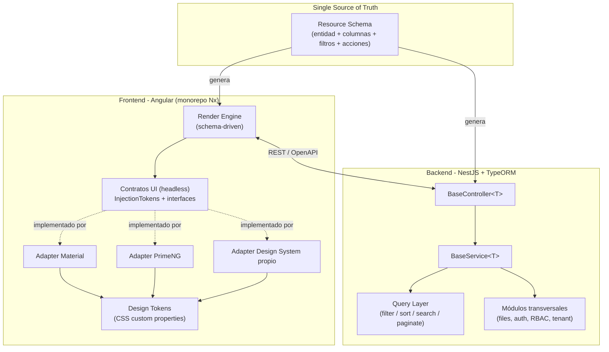
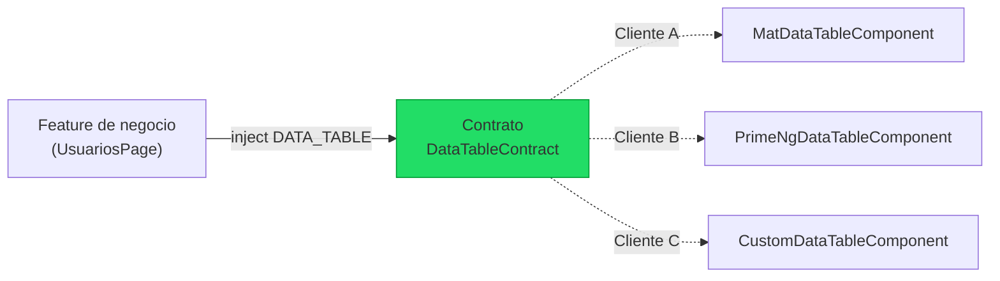
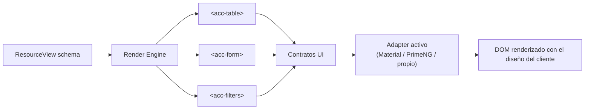
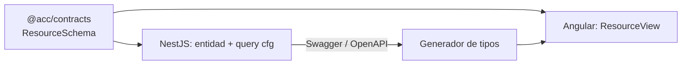
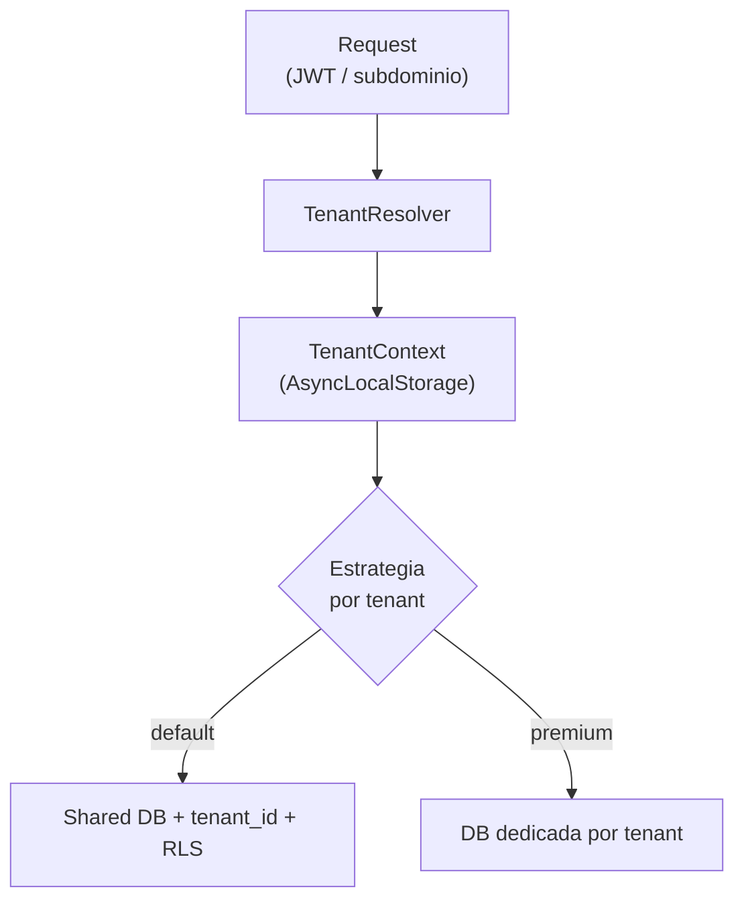

# ADR-001: Arquitectura del acelerador de dashboards (NestJS + Angular)

**Estado:** Propuesto
**Fecha:** 2026-07-08
**Autor:** Alfonso Domínguez
**Deciders:** Equipo de arquitectura / liderazgo técnico

---

## 1. Contexto

Queremos construir un **acelerador de aplicaciones**: un software y un conjunto de librerías que permitan generar dashboards de negocio (paneles CRUD administrativos) de forma rápida y repetible para distintos clientes.

Fuerzas en juego:

- **Alto grado de repetición.** La mayoría de los dashboards comparten los mismos patrones: tablas paginadas con búsqueda, filtrado y ordenación; formularios de alta/edición; subida y descarga de ficheros; autenticación multi-tenant; gestión de roles y permisos.
- **Diseños distintos por cliente.** Cada cliente quiere su propia identidad visual y, a menudo, su propia librería de componentes (Angular Material, PrimeNG, un design system propio, etc.). El acelerador debe entregar el mismo producto funcional con pieles radicalmente diferentes.
- **El riesgo principal es el acoplamiento de la UI.** Si el código de negocio importa componentes concretos de una librería, cambiar de librería implica reescribir features. Ese acoplamiento es lo que mata la reutilización.
- **Time-to-market.** El valor del acelerador está en reducir semanas de desarrollo a días. La generación/automatización de código es un objetivo explícito, no un lujo.

### Requisitos

**Funcionales**

- Tablas server-side con paginación, filtrado múltiple, búsqueda global y ordenación.
- Formularios CRUD generados a partir de una definición.
- Módulos transversales: subida/descarga de ficheros, autenticación, RBAC, multi-tenant.
- Capacidad de intercambiar la librería de componentes UI por cliente sin tocar la lógica de negocio.

**No funcionales**

- **Sustituibilidad de la UI** como propiedad de primera clase.
- **DX (developer experience):** un desarrollador debe poder levantar un dashboard nuevo definiendo un esquema, no escribiendo boilerplate.
- **Aislamiento de tenants** configurable según las necesidades de cada cliente.
- **Mantenibilidad:** un bug corregido en el core se propaga a todos los proyectos.

---

## 2. Decisión

Adoptamos una arquitectura de **cuatro capas desacopladas** en un **monorepo (Nx)**:

1. **Contratos UI (headless):** interfaces + `InjectionToken` de Angular que definen las primitivas de UI sin implementación.
2. **Adapters de librería:** paquetes intercambiables que implementan los contratos con Material, PrimeNG o un design system propio.
3. **Render engine schema-driven:** un motor que interpreta una definición declarativa (JSON/TS) de cada vista y la pinta usando únicamente los contratos abstractos.
4. **Backend genérico NestJS + TypeORM:** clases base y una capa de query que traducen los parámetros REST a consultas dinámicas, más módulos transversales reutilizables.

Un **único esquema de recurso** (single source of truth) alimenta tanto el backend como el frontend, y un generador emite el andamiaje para ambos.

La estrategia de **multi-tenant** se decide por proyecto entre tres modelos (ver sección 6), con **columna discriminadora con Row-Level Security** como recomendación por defecto.

---

## 3. Vista de capas



La regla de oro: **el Render Engine y las features de negocio solo conocen los Contratos UI, nunca un adapter concreto.** Cambiar de diseño para un cliente = proveer otro adapter en el arranque de la app.

---

## 4. Frontend: desacoplamiento de la UI

### 4.1 Contratos headless

Definimos la UI como un conjunto de **contratos abstractos** (clases abstractas o interfaces) más `InjectionToken`. El código de negocio depende de la abstracción, y Angular inyecta la implementación concreta en tiempo de arranque.

```typescript
// contracts/data-table.contract.ts
export interface TableColumn<T> {
  field: keyof T & string
  header: string
  sortable?: boolean
  filter?: 'text' | 'select' | 'date' | 'number'
  cell?: (row: T) => string // formateo opcional
}

export interface DataTableRequest {
  page: number
  pageSize: number
  sort?: { field: string; dir: 'asc' | 'desc' }
  filters?: Record<string, unknown>
  search?: string
}

export interface DataTablePage<T> {
  rows: T[]
  total: number
}

// Contrato que TODO adapter de tabla debe cumplir
export abstract class DataTableContract<T = unknown> {
  abstract columns: TableColumn<T>[]
  abstract data: DataTablePage<T>
  abstract loading: boolean
  abstract request: (req: DataTableRequest) => void // emite cambios de página/sort/filter
}

export const DATA_TABLE = new InjectionToken<Type<DataTableContract>>('DATA_TABLE')
```

Lo mismo se define para las demás primitivas: `BUTTON`, `DIALOG_SERVICE`, `FORM_FIELD`, `TOAST_SERVICE`, `FILE_UPLOAD`, `SELECT`, `DATE_PICKER`, etc. El conjunto de contratos es el "kernel" estable del acelerador.

### 4.2 Adapters por librería

Cada librería vive en su **propio paquete** del monorepo e implementa los contratos. Cambiar de librería es cambiar qué paquete se registra.

```typescript
// adapter-material/material.providers.ts
export const materialUiProviders: Provider[] = [
  { provide: DATA_TABLE, useValue: MatDataTableComponent },
  { provide: DIALOG_SERVICE, useClass: MatDialogService },
  { provide: BUTTON, useValue: MatButtonComponent }
  // ...
]

// app.config.ts  (cliente A → Material)
export const appConfig: ApplicationConfig = {
  providers: [...materialUiProviders]
}

// app.config.ts  (cliente B → PrimeNG, sin tocar nada más)
export const appConfig: ApplicationConfig = {
  providers: [...primengUiProviders]
}
```



### 4.3 Design tokens

Los valores visuales (color, spacing, tipografía, radios, sombras) se definen como **CSS custom properties** independientes de la librería. Así se puede rebrandear sin cambiar de adapter, y los adapters mapean estos tokens a las variables de su librería.

```css
:root {
  --acc-color-primary: #2563eb;
  --acc-radius-md: 8px;
  --acc-font-family: 'Inter', sans-serif;
  --acc-space-4: 1rem;
}
```

### 4.4 UI declarativa (schema-driven)

Aquí está el multiplicador de productividad. En lugar de escribir cada pantalla a mano, se **describe** con un esquema y el Render Engine la pinta usando los contratos.

```typescript
// users.dashboard.ts
export const usersDashboard: ResourceView = {
  resource: 'users',
  endpoint: '/api/users',
  table: {
    columns: [
      { field: 'name', header: 'Nombre', sortable: true, filter: 'text' },
      { field: 'email', header: 'Email', filter: 'text' },
      { field: 'role', header: 'Rol', filter: 'select' },
      { field: 'createdAt', header: 'Alta', sortable: true, filter: 'date' }
    ],
    search: ['name', 'email'],
    actions: ['create', 'edit', 'delete', 'export']
  },
  form: {
    fields: [
      { name: 'name', type: 'text', required: true },
      { name: 'email', type: 'email', required: true },
      { name: 'role', type: 'select', optionsEndpoint: '/api/roles' }
    ]
  }
}
```

El mismo esquema produce una tabla idéntica en Material o PrimeNG. Añadir un dashboard = añadir un esquema.



### 4.5 Aviso honesto sobre la abstracción

La paridad perfecta entre librerías es una ilusión cara. Difieren en features (virtual scroll, edición inline, agrupación de filas, tree tables). Recomendación: **diseñar los contratos para el 80 % común y ofrecer "escape hatches"** (por ejemplo, permitir proyectar un `TemplateRef` específico de una librería para casos límite) en lugar de perseguir cobertura del 100 %. Cada primitiva añadida al kernel es un coste de mantenimiento en _todos_ los adapters.

---

## 5. Backend: automatización con NestJS + TypeORM

### 5.1 Capa de query genérica

Un único parser traduce los query params REST a un `FindManyOptions`/`QueryBuilder` de TypeORM, con whitelisting de campos filtrables/ordenables para evitar inyección y sobre-exposición.

```typescript
// GET /api/users?page=1&pageSize=20&sort=createdAt:desc
//   &filter[role]=admin&filter[createdAt][gte]=2026-01-01&search=alfonso

@Injectable()
export class QueryBuilderService {
  build<T>(repo: Repository<T>, query: ListQueryDto, cfg: ResourceQueryConfig<T>) {
    const qb = repo.createQueryBuilder('e')

    // Búsqueda global sobre campos permitidos
    if (query.search && cfg.searchable.length) {
      qb.andWhere(
        new Brackets(w => {
          cfg.searchable.forEach((f, i) => w.orWhere(`e.${f} ILIKE :s`, { s: `%${query.search}%` }))
        })
      )
    }

    // Filtros por campo (solo whitelisted)
    for (const [field, cond] of Object.entries(query.filter ?? {})) {
      if (!cfg.filterable.includes(field)) continue
      applyOperator(qb, `e.${field}`, cond) // eq, gte, lte, in, like...
    }

    // Orden (solo whitelisted)
    if (query.sort && cfg.sortable.includes(query.sort.field)) {
      qb.orderBy(`e.${query.sort.field}`, query.sort.dir.toUpperCase() as 'ASC' | 'DESC')
    }

    // Paginación
    qb.skip((query.page - 1) * query.pageSize).take(query.pageSize)
    return qb
  }
}
```

### 5.2 Clases base

`BaseController<T>` + `BaseService<T>` dan CRUD, paginación, filtrado y orden "gratis" por entidad. Un recurso nuevo se reduce a extender y declarar su configuración.

```typescript
export class BaseService<T extends ObjectLiteral> {
  constructor(
    protected repo: Repository<T>,
    protected qb: QueryBuilderService,
    protected cfg: ResourceQueryConfig<T>
  ) {}

  list(q: ListQueryDto): Promise<DataTablePage<T>> {
    const query = this.qb.build(this.repo, q, this.cfg)
    return query.getManyAndCount().then(([rows, total]) => ({ rows, total }))
  }
  // create, findOne, update, remove...
}

@Controller('users')
export class UsersController extends BaseController<User> {
  constructor(svc: UsersService) {
    super(svc)
  }
}
```

### 5.3 Módulos transversales

Cada capacidad común se empaqueta como **módulo NestJS configurable** (`forRoot`/`forRootAsync`) reutilizable entre proyectos:

- **`@acc/files`** — subida/descarga con abstracción de storage (local, S3, Azure Blob), validación de tipo/tamaño, streaming de descargas.
- **`@acc/auth`** — JWT/refresh, integración OIDC, y contexto de tenant.
- **`@acc/rbac`** — roles y permisos con guards e decoradores.
- **`@acc/tenant`** — resolución de tenant y aplicación transparente del aislamiento (ver sección 6).

### 5.4 Contrato compartido front-back

El **ResourceSchema** vive una sola vez. Del lado backend define entidad + configuración de query; del lado frontend define la vista. Se comparte en un paquete `@acc/contracts` del monorepo, y OpenAPI (Swagger de Nest) genera los tipos del cliente Angular, garantizando que front y back nunca se desincronicen.



---

## 6. Multi-tenant: opciones y recomendación

Es la decisión más difícil de revertir porque contamina el modelo de datos, la capa de acceso y la operación. Tres modelos:

### Opción A — Columna discriminadora (`tenant_id`)

Todas las tablas llevan `tenant_id`; el filtrado por tenant se aplica de forma transversal.

| Dimensión            | Valoración                                          |
| -------------------- | --------------------------------------------------- |
| Complejidad          | Baja                                                |
| Coste                | Bajo (una sola BD)                                  |
| Aislamiento          | Bajo–medio (lógico)                                 |
| Escalabilidad        | Alta hasta cierto punto; tablas grandes compartidas |
| Onboarding de tenant | Instantáneo                                         |

**Pros:** máxima simplicidad operativa, migraciones únicas, coste mínimo, onboarding inmediato.
**Cons:** el aislamiento depende de que _nunca_ falle un filtro (riesgo de fuga entre tenants); "ruidoso vecino" en rendimiento; difícil dar backups/exportaciones por cliente.

> **Mitigación clave:** activar **Row-Level Security (RLS) de PostgreSQL**. La base de datos fuerza el aislamiento aunque una query olvide el `WHERE tenant_id`. Esto convierte el mayor punto débil de la opción A en un riesgo controlado.

### Opción B — Schema por tenant

Una BD, un schema Postgres por tenant, mismas tablas replicadas.

| Dimensión            | Valoración                           |
| -------------------- | ------------------------------------ |
| Complejidad          | Media                                |
| Coste                | Medio                                |
| Aislamiento          | Medio–alto                           |
| Escalabilidad        | Buena hasta cientos/miles de schemas |
| Onboarding de tenant | Requiere crear/migrar schema         |

**Pros:** buen equilibrio aislamiento/coste; backups y export por tenant más sencillos; sin riesgo de fuga por filtro olvidado.
**Cons:** las migraciones deben aplicarse a N schemas (herramienta necesaria); la conexión debe fijar `search_path` por request; degrada con muchísimos tenants.

### Opción C — Base de datos por tenant

Una BD (o instancia) por cliente.

| Dimensión            | Valoración                                         |
| -------------------- | -------------------------------------------------- |
| Complejidad          | Alta                                               |
| Coste                | Alto                                               |
| Aislamiento          | Máximo                                             |
| Escalabilidad        | Excelente por tenant; pesada de operar en conjunto |
| Onboarding de tenant | Aprovisionamiento completo                         |

**Pros:** aislamiento total (seguridad, rendimiento, residencia de datos por región); ideal para clientes enterprise/regulados; escalado y tuning independiente.
**Cons:** coste y complejidad operativa altos; orquestación de migraciones y despliegues; onboarding lento; observabilidad fragmentada.

### Análisis de trade-offs

El eje es **aislamiento vs. coste/complejidad operativa**. Para un acelerador que quiere vender rápido a muchos clientes B2B de tamaño pequeño-medio, la simplicidad de onboarding y operación pesa mucho; el aislamiento por seguridad puede resolverse con RLS.

### Recomendación

**Empezar con Opción A (columna discriminadora) + Row-Level Security**, diseñando la capa de acceso (`@acc/tenant`) detrás de una **abstracción que permita migrar a schema-per-tenant sin tocar el código de negocio**. Concretamente:

- El `tenant_id` nunca se pasa manualmente en las queries: lo inyecta un interceptor/subscriber a partir del contexto de request (JWT/subdominio), y RLS lo blinda a nivel de BD.
- Para clientes enterprise que exijan aislamiento físico o residencia regional, se ofrece **Opción C como tier premium** reutilizando la misma capa de conexión (solo cambia el enrutado de datasource por tenant).
- Se evita la Opción B como default salvo requisito explícito, porque el coste de migraciones multi-schema rara vez compensa frente a A+RLS.



---

## 7. Monorepo (Nx)

```
acelerador/
├── apps/
│   ├── api/                 # NestJS
│   └── admin-web/           # Angular (shell del dashboard)
├── libs/
│   ├── contracts/           # ResourceSchema compartido front+back
│   ├── ui-contracts/        # Contratos headless (InjectionTokens)
│   ├── ui-adapter-material/ # Adapter Material
│   ├── ui-adapter-primeng/  # Adapter PrimeNG
│   ├── ui-tokens/           # Design tokens
│   ├── render-engine/       # Motor schema-driven
│   ├── data-access/         # Cliente REST tipado
│   └── nest-core/           # BaseController/Service, QueryBuilder, módulos transversales
└── tools/
    └── generators/          # Generadores Nx (scaffolding de recurso)
```

Nx aporta: límites de dependencia forzados (un feature no puede importar un adapter concreto → se prohíbe por lint de módulos), caché de builds, y **generadores** para hacer scaffolding de un recurso completo (entidad Nest + esquema Angular) desde un comando.

---

## 8. Consecuencias

**Se vuelve más fácil**

- Entregar el mismo producto con diseños distintos por cliente (cambiar un provider).
- Crear un dashboard nuevo (definir un esquema, no escribir boilerplate).
- Propagar correcciones del core a todos los proyectos.
- Escalar el catálogo de clientes con onboarding rápido (multi-tenant A).

**Se vuelve más difícil**

- La inversión inicial: los contratos, el primer adapter y el render engine son trabajo de plataforma antes de ver retorno.
- Mantener paridad de features entre adapters (mitigado con escape hatches).
- Casos de UI muy específicos que no encajan en el esquema (se resuelven con slots/templates custom).

**A revisar**

- Cuándo un cliente justifica saltar a DB-per-tenant.
- Límite de crecimiento del kernel de contratos (evitar que se hinche).
- Estrategia de versionado del esquema y migración de dashboards existentes.

---

## 9. Action items

1. [ ] Definir el conjunto mínimo de contratos UI del kernel (tabla, form-field, button, dialog, toast, select, date-picker, file-upload).
2. [ ] Implementar el primer adapter (Material) como referencia.
3. [ ] Prototipar el Render Engine con el esquema `ResourceView` y una tabla end-to-end.
4. [ ] Construir `nest-core`: `QueryBuilderService`, `BaseController/Service`, DTOs de listado.
5. [ ] Implementar `@acc/tenant` con AsyncLocalStorage + RLS en PostgreSQL.
6. [ ] Configurar el monorepo Nx con límites de dependencia y un generador de recurso.
7. [ ] Validar el desacoplamiento levantando la misma app con dos adapters distintos.

```

```
