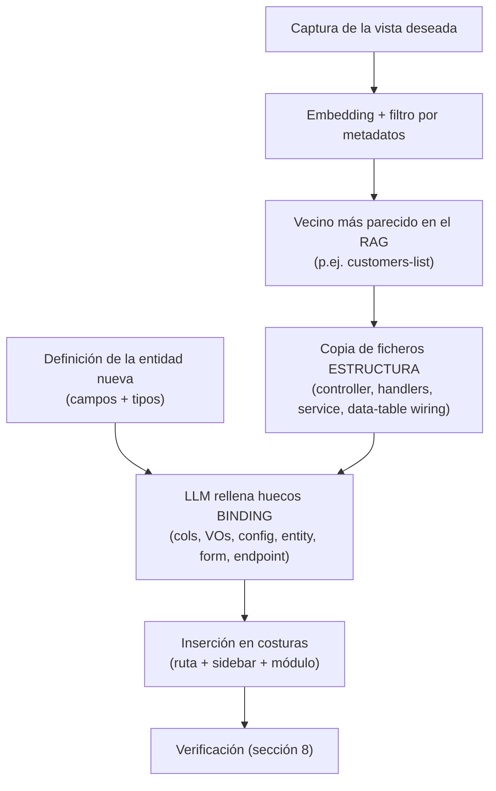

# Contrato de una unidad-vista para el RAG

**Plantilla de referencia:** el módulo `customers` de `sap-licences` (back + front)
**Fecha:** 2026-07-10
**Propósito:** definir qué es una "pieza" almacenable en el RAG, qué debe cumplir para ser conforme al esqueleto, qué se indexa, y qué partes son huecos que el LLM rellena al ensamblar.

---

## 0. Idea en una frase

Una **unidad-vista** es un módulo de feature completo (back + front) que resuelve un patrón de pantalla —tabla paginada con búsqueda/filtros/orden + CRUD + export—, **depende solo del esqueleto**, y expone su parte específica del dominio en un puñado de ficheros bien localizados. El RAG guarda la *forma* (idéntica entre vistas) junto a una captura; el LLM, al insertarla, deriva el *binding* concreto de la entidad nueva.

La clave que hace todo esto viable ya está en el proyecto: **una vista nunca importa otra vista.** Solo importa de `shared`/`core`/`ui`. Esa dirección de dependencias es el contrato de compatibilidad, y es forzable por lint de módulos de Nx.

---

## 1. Frontera esqueleto ↔ pieza (verificada sobre el código real)

### Esqueleto — backend (`libs/backend/src/contexts/shared/` + `iam`)

| Elemento | Rol |
|---|---|
| `shared/domain/query/` (`criteria`, `filter`, `filters`, `order`, `global-search`, `cursor`) | Lenguaje genérico de filtrado/orden/búsqueda/paginación |
| `shared/infrastructure/pipes/parse-criteria.pipe.ts` | Traduce query params REST → Criteria |
| `shared/infrastructure/pipes/parse-uuid-v7.pipe.ts` | Validación de IDs |
| `shared/infrastructure/dtos/paginate-offset.dto.ts` | DTO de paginación |
| `shared/application/dtos/search-output.dto.ts` (`OffsetPaginatedOutput<T>`) | Forma de respuesta paginada |
| `shared/infrastructure/export/build-export-file.ts` | Genera CSV/XLSX desde filas + columnas |
| `shared/infrastructure/{filters,interceptors,logger,config,telemetry,http,persistence}` | Cross-cutting |
| `iam/modules/auth` | Autenticación |

### Esqueleto — frontend (`libs/frontend/src/{core,shared}` + `libs/ui/*` + `layout`)

| Elemento | Rol |
|---|---|
| `shared/components/data-table.ts` (`DataTable`, `ColumnDef`, `ColumnFilter`, `SortOrder`, `TableAction`) | Tabla server-side genérica: paginación, orden, filtros, búsqueda, export, create, acciones |
| `core/http/` (`api-base-url` token + interceptors, `auth.interceptor`) | Base HTTP transversal |
| `core/services/export-filename.ts` | Parseo de `Content-Disposition` |
| `shared/utils/` (`uuid`, `download-file`) | Utilidades |
| `libs/ui/*` (Spartan NG: dialog, alert-dialog, button, form-field, pagination…) | Primitivos de UI |
| `domains/admin/layout/sidebar` | Layout/navegación |

> Nota sobre el desacoplamiento de librería: hoy las vistas usan directamente `HlmDialogImports`, `HlmButtonImports`, etc. Si en el futuro quieres pieles intercambiables por cliente (la idea de los *adapters*), esos imports Spartan deberían pasar tras contratos headless. **Para el RAG no es bloqueante**: mientras todas las piezas usen el mismo conjunto de primitivos, siguen siendo conformes entre sí. El desacoplamiento de librería es una capa ortogonal que se añade cuando haga falta.

### Pieza (unidad-vista) — lo que aporta `customers`

Todo lo que cuelga de `sap-licensing/modules/customers` (back) y `sap-licensing/features/customers` (front). Es la misma forma en `licenses`, `contracts`, `projects` → eso es lo repetible que va al RAG.

---

## 2. Anatomía de una pieza

### 2.1 Backend — ficheros de una unidad-vista

```
modules/customers/
├── customers.module.ts                         [ESTRUCTURA]  wiring del módulo Nest
├── application/
│   ├── config/search-customer-config.ts        [BINDING]     allowedFilters/Orders/searchable
│   ├── use-cases/*.service.ts                   [ESTRUCTURA]  search/get/register/update/remove/export/sync
│   ├── handlers/*.handler.ts                    [ESTRUCTURA]  1 por caso de uso
│   ├── dtos/*-input.dto.ts                      [BINDING]     campos del dominio
│   └── factories/customer-input.mapper.ts       [BINDING]     mapeo input → dominio
├── domain/
│   ├── customer-types.ts (CustomerPrimitiveProps)[BINDING]    forma de la entidad
│   └── value-objects/*.vo.ts                    [BINDING]     sap-id, tax-id, industry, phone…
└── infrastructure/
    ├── entrypoints/
    │   ├── customers.controller.ts              [ESTRUCTURA]  usa ParseCriteriaPipe + OffsetPaginatedOutput + buildExportFile
    │   ├── customers-export-columns.ts          [BINDING]     columnas de export
    │   └── dtos/*.dto.ts                         [BINDING]     DTOs de entrada REST
    ├── persistence/typeorm/
    │   ├── typeorm-customer.entity.ts           [BINDING]     tabla + columnas
    │   ├── customer.mapper.ts                    [BINDING]     entity ↔ dominio
    │   └── typeorm-customer.repository.ts        [ESTRUCTURA]  apoyado en Criteria del esqueleto
    └── seed/*                                    [BINDING]     datos de ejemplo
```

El `customers.controller.ts` es el mejor ejemplo de **estructura pura**: no contiene nada específico de cliente salvo la ruta `@Controller('customers')`. Todo el trabajo pesado lo delega al esqueleto:

```typescript
@Get()
search(@Query(new ParseCriteriaPipe()) query: PaginateOffsetDto)
  : Promise<OffsetPaginatedOutput<CustomerPrimitiveProps>> {
  return this.searchCustomersHandler.handle(query)   // ParseCriteriaPipe y OffsetPaginatedOutput son esqueleto
}
```

Y `search-customer-config.ts` es el mejor ejemplo de **binding puro**: es literalmente la lista de campos de la entidad que se pueden filtrar/ordenar/buscar.

```typescript
const CUSTOMER_ALLOWED_FILTERS = ['id','sapId','name','taxId','industry','assignedKamId'] as const
const CUSTOMER_ALLOWED_ORDERS  = ['name','sapId','taxId','industry'] as const
const CUSTOMER_SEARCHABLE_FIELDS = ['name','industry','taxId','address','phone'] as const
```

### 2.2 Frontend — ficheros de una unidad-vista

```
features/customers/
├── customers-list.component.ts     [ESTRUCTURA + BINDING]  usa <app-data-table>; columns[] y actions[] son binding
├── customer-dialog.component.ts    [BINDING]               campos del formulario
└── customer-detail.component.ts    [BINDING]               ficha de detalle
core/services/
└── customer.service.ts             [ESTRUCTURA + BINDING]  endpoint + DTO son binding; resource()/criteriaParams estructura
```

`customers-list.component.ts` deja la frontera clarísima. Toda la mecánica (loading/empty/error, paginación, orden, filtros, búsqueda, export, diálogos de crear/editar/borrar) es **estructura** que se apoya en `<app-data-table>` del esqueleto. Lo único específico del dominio son dos arrays:

```typescript
// BINDING — se deriva de la entidad
readonly columns: ColumnDef[] = [
  { key: 'name',     label: 'Nombre',    filterable: true, minWidth: 220 },
  { key: 'industry', label: 'Industria', filterable: true, minWidth: 180 },
  { key: 'taxId',    label: 'CIF / NIF', filterable: true, minWidth: 130 },
  { key: 'address',  label: 'Dirección', sortable: false,  minWidth: 250 },
  { key: 'phone',    label: 'Teléfono',  sortable: false,  minWidth: 150 }
]
readonly actions: TableAction[] = [
  { icon: 'lucideEye',    label: 'Ver ficha', action: 'view' },
  { icon: 'lucidePencil', label: 'Editar',    action: 'edit' },
  { icon: 'lucideTrash2', label: 'Eliminar',  action: 'delete', variant: 'ghost' }
]
```

Y en `customer.service.ts`, la **estructura** es el `resource()` + `criteriaParams()` (idénticos entre vistas), y el **binding** son el endpoint y el tipo:

```typescript
// BINDING — endpoint + DTO
this._http.get<OffsetPaginatedOutput<CustomerDto>>('/api/v1/customers', { params })
```

> **Coherencia crítica front↔back**: los `columns[].key` sortables/filterables del front deben ser un subconjunto de `CUSTOMER_ALLOWED_ORDERS/FILTERS` del back, o la API responde 400. Esto ya está documentado en un comentario del propio componente. El generador debe producir ambos desde **la misma definición de campos** para que nunca se desincronicen — es el argumento a favor del esquema-de-recurso único.

---

## 3. Contrato de admisión al RAG

Una pieza es **almacenable y componible** si y solo si:

1. **Aislamiento**: importa únicamente de `shared`, `core`, `libs/ui` y `shared/domain`. **Nunca** de otro módulo/feature. (Forzable con `@nx/enforce-module-boundaries`.)
2. **Layout canónico**: respeta la estructura de carpetas y los roles de fichero de la sección 2 (back: application/domain/infrastructure; front: list + dialog + detail + service).
3. **Binding localizado y declarado**: todo lo específico del dominio vive solo en los ficheros marcados `[BINDING]`. Ningún dato de dominio "se cuela" en ficheros de estructura.
4. **Estados no-felices completos**: el componente lista contempla loading, empty, error y filtros/búsqueda activos con cero resultados (como ya hace `customers-list`).
5. **Testeada en verde**: la pieza trae sus specs (`*.spec.ts`) y pasan aisladas.

Si una pieza no cumple (1), se rechaza: contaminaría el RAG con acoplamiento entre vistas.

---

## 4. Qué se indexa

Cada muestra del RAG = **captura + código + metadatos estructurados**. No indexar solo píxeles; la recuperación híbrida (filtrar por metadatos y luego comparar aspecto) es mucho más precisa.

```jsonc
{
  "id": "customers-list",
  "screenshot": "customers-list.png",           // clave de búsqueda visual (embedding)
  "kind": "list+crud+export",                    // patrón de pantalla
  "features": ["pagination","search","filters","sort","export","create","edit","delete","detail"],
  "ui_primitives": ["data-table","dialog","alert-dialog","button"],
  "field_types": ["text","select","date"],       // tipos presentes → guía el binding
  "back_files": ["modules/customers/**"],
  "front_files": ["features/customers/**","core/services/customer.service.ts"],
  "binding_holes": [ /* ver sección 5 */ ],
  "seams": [ /* ver sección 6 */ ]
}
```

El flujo de recuperación: embebes la captura objetivo → filtras candidatos por `kind`/`features` → eliges el más parecido visualmente → recuperas su código.

---

## 5. Los huecos de binding (lo que el LLM deriva de la entidad nueva)

Al insertar la pieza, esto **no se copia** del vecino: se genera a partir de la definición de la entidad destino.

**Backend**
- `domain/customer-types.ts` → props de la entidad nueva.
- `domain/value-objects/*` → un VO por campo con reglas.
- `application/config/search-*-config.ts` → allowedFilters/Orders/searchable.
- `infrastructure/persistence/typeorm/*.entity.ts` + mapper → tabla y columnas.
- `infrastructure/entrypoints/*-export-columns.ts` → columnas de export.
- DTOs de entrada.

**Frontend**
- `columns: ColumnDef[]` y `actions: TableAction[]` en el `*-list.component.ts`.
- Campos del formulario en `*-dialog.component.ts`.
- Contenido de la ficha en `*-detail.component.ts`.
- Endpoint (`/api/v1/<recurso>`) y tipo `Dto` en el `*.service.ts`.
- Etiquetas de texto visibles (títulos, labels en español).

Todo lo demás (controller, handlers, use-cases, `resource()`, `criteriaParams()`, mecánica de la tabla y de los diálogos) **se copia tal cual**, porque es idéntico entre vistas.

---

## 6. Las costuras de ensamblaje (dónde se enchufa la pieza)

Tres puntos de inserción, ninguno dentro de la pieza:

| Costura | Fichero | Qué se añade |
|---|---|---|
| Ruta (front) | `sap-licensing/sap-licensing.routes.ts` | entrada de ruta a la nueva feature |
| Navegación (front) | `domains/admin/layout/sidebar` | ítem de menú |
| Registro (back) | módulo de contexto `sap-licensing` | alta del nuevo `*.module.ts` |

El controller ya define su propia ruta base (`@Controller('customers')`), así que el prefijo REST viaja con la pieza. Las costuras son exactamente lo que un generador (o el LLM) modifica al insertar.

---

## 7. Flujo end-to-end de uso



---

## 8. Verificación de una pieza ensamblada

Una vista insertada se da por correcta solo si:

1. **Compila y linta**: incluido `@nx/enforce-module-boundaries` (prueba de que no se coló acoplamiento).
2. **Coherencia front↔back**: los campos sortable/filterable del front ⊆ allowedOrders/Filters del back.
3. **Specs en verde**: las specs copiadas + las adaptadas al nuevo dominio pasan.
4. **Estados no-felices**: loading/empty/error/filtros-sin-resultados presentes.
5. **Gate visual**: la pantalla renderizada se compara con la captura del RAG (Playwright MCP), confirmando que el binding no rompió el layout.

---

## 9. Conclusión operativa

El proyecto ya demuestra que la forma es repetible y el binding es pequeño y localizado. Convertir esto en un acelerador RAG no requiere reescribir nada: requiere (a) **etiquetar** cada módulo con sus metadatos y su captura, (b) **marcar** en cada pieza qué ficheros son binding, y (c) tener una **definición de entidad** de la que derivar los huecos. El único punto que conviene reforzar antes de escalar es la **coherencia front↔back de campos**, que hoy se mantiene a mano por comentario y que un esquema-de-recurso único eliminaría de raíz.
