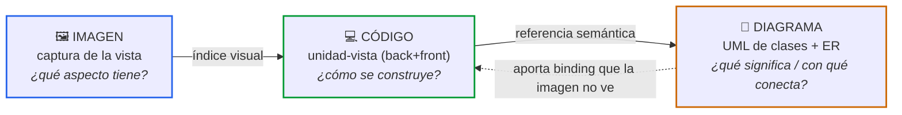
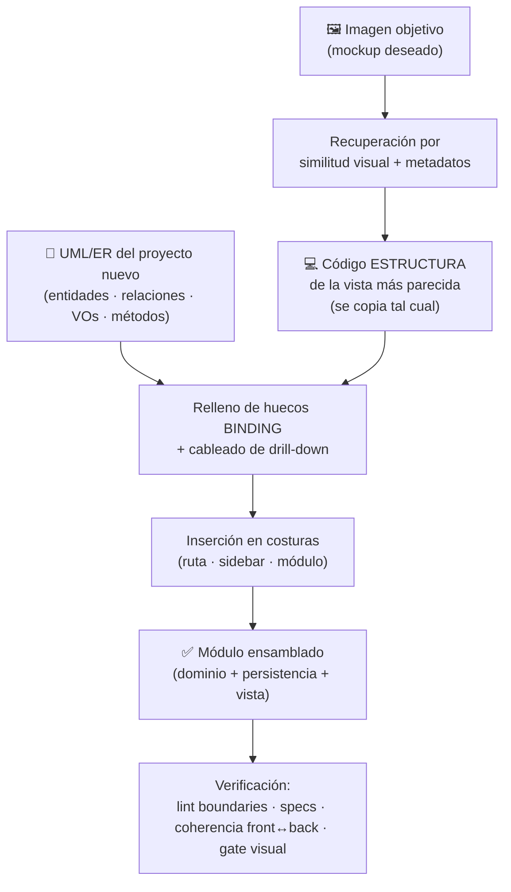
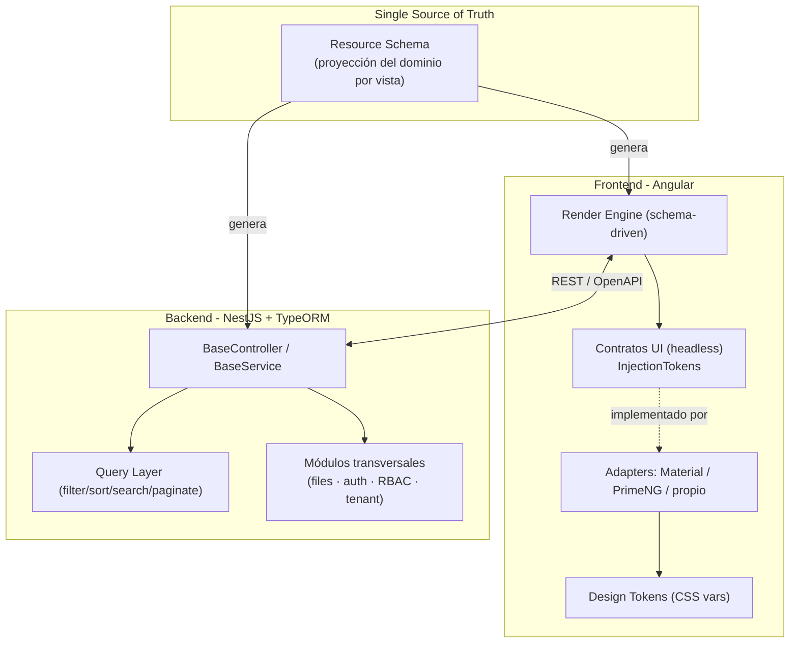
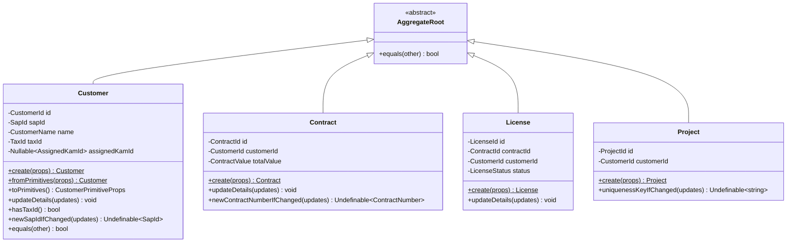
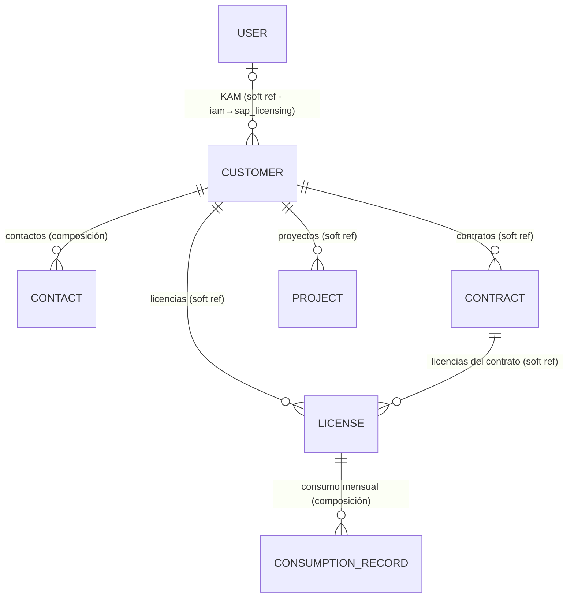
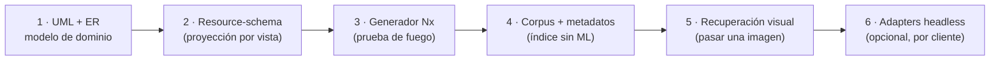

# Dossier de arquitectura — Acelerador de dashboards

**Fecha:** 2026-07-10
**Autor:** Alfonso Domínguez
**Estado:** Brainstorming (previo a spec)
**Caso de referencia:** el proyecto `sap-licences` (NestJS + Angular, Nx, DDD)

> Documento maestro que integra las cuatro piezas trabajadas: la arquitectura general, el modelo de combinación imagen+código+diagrama, el modelo de dominio (UML de clases + ER) y el contrato de la unidad-vista. Los documentos hermanos (`arquitectura-acelerador-dashboards.md`, `uml-clases-dominio.md`, `uml-modelo-dominio.md`, `contrato-unidad-vista-rag.md`) contienen el detalle a nivel de fichero; este dossier es la visión coherente del conjunto.

---

## 0. Resumen ejecutivo

Queremos un **acelerador**: generar dashboards de negocio (tablas paginadas con filtros/orden/búsqueda + CRUD + export + módulos transversales) de forma rápida y repetible, con diseños intercambiables por cliente.

La idea central, madurada a lo largo del diseño, es que **una vista nueva no se escribe: se recupera y se re-liga.** Para eso combinamos tres artefactos que operan en planos distintos:

- **Imagen** (captura de la vista) → _qué aspecto tiene_. Clave de búsqueda.
- **Código** (unidad-vista: estructura reutilizable + binding específico) → _cómo se construye_. Lo que se ensambla.
- **Diagramas** (UML de clases + ER) → _qué significa y con qué se conecta_. La semántica: entidades, relaciones, comportamiento.

Sobre un **esqueleto tested y libre de bugs**, cada pieza es conforme (depende solo del esqueleto, nunca de otra pieza), y el sistema copia la _forma_ (idéntica entre vistas) mientras deriva el _binding_ del modelo de dominio.

---

## 1. El modelo de combinación (la pieza central)

### 1.1 Cada muestra del RAG es un triplete enlazado

Una entrada del corpus no es "imagen + código" sueltos, sino tres nodos que se apuntan entre sí. Dado cualquiera, llegas a los otros dos.

La imagen indexa la **forma**; el diagrama indexa el **significado**; el código es la **intersección** de ambos.

### 1.2 Flujo de generación de una vista nueva

### 1.3 Por qué hacen falta los tres (si quitas uno, se rompe algo)

| Falta…   | Se rompe…                                                                                                                                                                                                            |
| -------- | -------------------------------------------------------------------------------------------------------------------------------------------------------------------------------------------------------------------- |
| Imagen   | La UX de autoría: no hay forma rápida de decir "quiero algo así".                                                                                                                                                    |
| Código   | La reutilización: vuelves a escribir boilerplate.                                                                                                                                                                    |
| Diagrama | La seguridad de las "pequeñas modificaciones": el LLM adivina tipos y conexiones desde píxeles. El UML de clases además aporta el **comportamiento** (invariantes de VOs, protocolo de mutación), no solo los datos. |

Esta es la razón por la que el ER no bastaba y hacía falta el UML de clases: **la imagen da la piel, el ER da los datos, pero el comportamiento y las invariantes solo los da el UML de clases.**

---

## 2. Pilar 1 — Arquitectura de capas y desacoplamiento de la UI

Cuatro capas desacopladas en un monorepo Nx:

**Desacoplamiento de librería (opcional, capa ortogonal).** El código de negocio depende de **contratos headless** (`InjectionToken` + interfaces); cada librería es un **adapter** intercambiable. Cambiar de diseño por cliente = proveer otro adapter en el arranque. Hoy el proyecto usa Spartan directamente; esta capa se añade solo cuando un cliente pida otra piel. Aviso: perseguir paridad perfecta entre librerías es caro — diseñar para el 80% común con _escape hatches_.

Detalle completo en `arquitectura-acelerador-dashboards.md`.

---

## 3. Pilar 2 — Modelo de dominio (la semántica)

Son dos vistas complementarias del mismo dominio. Ninguna sustituye a la otra.

### 3.1 UML de clases — el comportamiento

Los agregados comparten un **protocolo común** (estructura) y añaden sus VOs y reglas (binding).

El protocolo `create/fromPrimitives/toPrimitives/updateDetails/equals` es idéntico → **estructura plantillable**. Los atributos-VO, los VOs concretos con su `create()` validador y los métodos de unicidad → **binding derivado del modelo**. Cada campo es un Value Object con `private constructor` + `static create()` que valida invariantes.

### 3.2 ER — los datos y las conexiones

Todo cuelga de `CUSTOMER`, con relaciones **por referencia de ID** (DDD, sin FK dura entre contextos).

Dos tipos de arista que el generador trata distinto: **composición** (hijo propio, cascada: Customer→Contact, License→ConsumptionRecord) y **referencia entre contextos** (solo ID + lookup, drill-down entre vistas). Observaciones clave: denormalización deliberada (`customerName` copiado en contract/license/project), soft-delete transversal (`deletedAt`), y campos SAP vs. manuales en Customer.

Detalle completo en `uml-clases-dominio.md` y `uml-modelo-dominio.md`.

---

## 4. Pilar 3 — La unidad-vista y su contrato de conformidad

Una **unidad-vista** es un módulo completo (back + front) que resuelve un patrón de pantalla. La frontera **estructura ↔ binding**, verificada sobre `customers`:

- **Estructura (se copia):** controller, handlers, use-cases, `resource()`/`criteriaParams()`, mecánica de `<app-data-table>`, protocolo de agregado, interfaz de repositorio. Se apoya en el esqueleto (`shared/query`, `ParseCriteriaPipe`, `shared/components/data-table`).
- **Binding (se deriva del modelo):** entidad TypeORM + VOs, `search-*-config.ts` (filtrables/ordenables/buscables), `columns[]` y `actions[]` del front, campos del formulario, endpoint + DTO, y —lo que aporta el UML de clases— el **agregado con sus invariantes y specifications**.

**Contrato de admisión al RAG** (una pieza es almacenable y componible si y solo si):

1. **Aislamiento**: importa solo de `shared`/`core`/`ui`; nunca de otra vista. Forzable con `@nx/enforce-module-boundaries`.
2. **Layout canónico** de ficheros y roles.
3. **Binding localizado** en los ficheros marcados.
4. **Estados no-felices** completos (loading/empty/error/filtros sin resultados).
5. **Specs en verde** aisladas.

**Costuras de ensamblaje** (los únicos puntos que se tocan al insertar): ruta (`sap-licensing.routes.ts`), navegación (sidebar), registro del módulo Nest.

Detalle completo en `contrato-unidad-vista-rag.md`.

---

## 5. Multi-tenant

Decisión más difícil de revertir. Recomendación: **columna discriminadora (`tenant_id`) + Row-Level Security de PostgreSQL** por defecto, tras una abstracción (`@raptor/tenant` con `AsyncLocalStorage`) que permita migrar a **DB-por-tenant como tier premium** sin tocar el código de negocio. El `tenant_id` nunca se pasa a mano: lo inyecta un interceptor desde el contexto de request y RLS lo blinda en BD. Encaja con que todo cuelga de `CUSTOMER`. Trade-offs completos en el ADR.

---

## 6. Secuencia de construcción (por riesgo, no por vistosidad)

El RAG y la búsqueda visual son la última capa; lo que hace o rompe la idea es el split estructura/binding, que se valida sin ML.

1. **UML + ER** — el modelo de dominio (ya hecho para `sap-licences`). Fuente de todo binding.
2. **Resource-schema** — proyección del UML por vista; de él salen a la vez `columns[]` (front) y `search-config` (back), eliminando la coherencia manual.
3. **Generador** — dado el schema, emite el módulo completo. Métrica de éxito: generar una entidad nueva que compile, linte (boundaries), pase specs y gate visual.
4. **Corpus** — etiquetar módulos existentes con metadatos + captura + huecos de binding (índice del RAG sin ML).
5. **Recuperación visual** — embeddings + filtro por metadatos: la UX de "le paso una foto".
6. **Adapters headless** — pieles intercambiables, solo cuando un cliente lo pida.

**Recomendación:** el resource-schema de `customers` (paso 2) es el siguiente artefacto concreto; entrega valor aunque el RAG nunca se construya (ya tendrías generación schema-driven).

**Proceso:** esto sigue siendo brainstorming. El paso a código va por `/spec-new` con REQUIREMENTS/DESIGN/TASKS y TDD, no antes.

---

## 7. Consecuencias y riesgos

**Más fácil:** entregar el mismo producto con diseños distintos; crear una vista (definir schema); propagar fixes desde el core; onboarding rápido de tenants.

**Más difícil / riesgos a vigilar:**

- Inversión inicial de plataforma (esqueleto, contratos, generador) antes de ver retorno.
- Disciplina de conformidad: cada pieza debe cumplir el contrato de admisión o el corpus se degrada (mitigado con lint de boundaries).
- Coherencia front↔back de campos: hoy manual (por comentario); el resource-schema único la elimina de raíz — es la mejora a reforzar antes de escalar.
- Paridad de adapters y casos de UI que no encajan en el schema (mitigado con escape hatches / slots).
- Cuándo un cliente justifica DB-por-tenant.

---

## 8. Documentos del dossier

| Documento                               | Contenido                                                                      |
| --------------------------------------- | ------------------------------------------------------------------------------ |
| `dossier-acelerador-dashboards.md`      | Este documento maestro                                                         |
| `arquitectura-acelerador-dashboards.md` | ADR: capas, desacoplamiento UI, backend genérico, multi-tenant (detalle)       |
| `uml-clases-dominio.md`                 | UML de clases: agregados, VOs, puertos (con métodos)                           |
| `uml-modelo-dominio.md`                 | ER: entidades, relaciones, tipos de arista                                     |
| `contrato-unidad-vista-rag.md`          | Anatomía de la unidad-vista, contrato de admisión, huecos de binding, costuras |
