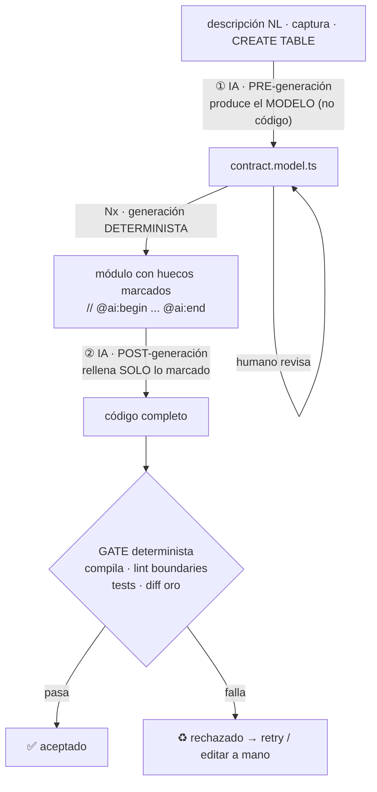

# Integración de IA en el generador

**Fecha:** 2026-07-10
**Estado:** Brainstorming (previo a spec)
**Premisa:** el generador Nx es **determinista y offline** (ver `guia-generador-nx.md`). La IA no sustituye ese núcleo: cubre los huecos que el determinismo no puede alcanzar.

---

## 1. Principio: determinismo en el centro, IA en los bordes, verificación en la frontera

El generador vale precisamente porque es determinista: misma entrada → mismo código, sin red, sin coste, sin sorpresas. Meter IA *dentro* del núcleo destruiría esa propiedad. Por eso la IA se coloca **alrededor**, en dos puntos concretos, y todo lo que produzca pasa por un **gate de verificación determinista** antes de aceptarse.



Regla de oro: **se confía en el gate, no en la IA.**

---

## 2. Los dos huecos que Nx no cubre (y dónde entra la IA)

### ① Pre-generación — la IA escribe el MODELO, no el código

El de **mayor valor y menor riesgo**. La entrada difusa (una descripción en lenguaje natural, un `CREATE TABLE`, una captura de una pantalla existente) se convierte en el `*.model.ts` estructurado. A partir de ahí, Nx genera de forma 100% determinista.

Por qué es seguro:

- La salida de la IA es **pequeña, estructurada y revisable de un vistazo** (un objeto con campos), no cientos de líneas de código.
- Si se equivoca, **editas el modelo y regeneras** — no depuras código generado.
- El código de producción **nunca lo toca la IA**: lo produce la plantilla.

```
Entrada (humano):
  "Una entidad contract con número de contrato único, cliente,
   valor total en euros, y un flag de favorito."

Salida (IA) → contract.model.ts:
  { name: 'contract', plural: 'contracts', context: 'sap-licensing',
    fields: [
      { name: 'contractNumber', tsType: 'string', column: 'varchar',
        required: true, unique: true, vo: 'ContractNumber',
        query: { sortable: true, filterable: true, searchable: true },
        table: { show: true, label: 'Nº contrato', minWidth: 160 },
        form: { control: 'text', label: 'Nº contrato' } },
      ...
    ] }

→ el humano revisa este objeto (segundos) y lanza el generador determinista.
```

### ② Post-generación — la IA rellena HUECOS MARCADOS

Lo que no se puede derivar del modelo: validación específica de un VO (dígito de control de un CIF), un método de negocio del agregado (calcular `consumptionPct`), casos de test con sentido, seed realista. La plantilla **marca** esos huecos con anclas explícitas:

```typescript
// contract-number.vo.ts (generado por la plantilla)
static create(value: string): ContractNumber {
  this.ensureIsString(value)
  value = this.normalize(value)
  // @ai:begin  regla: formato SAP AAAA-NNNNNN, validar estructura
  // TODO(ai): validación específica no derivable del modelo
  // @ai:end
  return new ContractNumber(value)
}
```

La pasada de relleno busca los bloques `@ai:begin … @ai:end` y pide al modelo que complete **solo dentro de los marcadores**, con el contexto alrededor como referencia. Esto **acota el radio de acción de la IA**: escribe en huecos delimitados, jamás en la estructura. Si no hay marcadores, la IA no toca nada.

| Hueco típico | Por qué el determinismo no llega |
|---|---|
| Validación de VO no trivial | Regla de negocio, no derivable de `min/max` |
| Método de negocio del agregado | Lógica específica (cálculos, transiciones de estado) |
| Tests de casos límite significativos | El molde solo da el happy path + estados; los edge cases dependen del dominio |
| Seed/fixtures realistas | Datos verosímiles, no aleatorios |
| Etiquetas/textos en español | Se pueden inferir del nombre del campo, pero la IA los mejora |

---

## 3. El gate de verificación (lo que hace segura a la IA)

Como la IA es no determinista, se envuelve en un gate **determinista**. El código —venga del molde o de la IA— no se acepta hasta que:

1. **Compila** (`tsc`, `strict`, sin `any`).
2. **Pasa `@nx/enforce-module-boundaries`** → prueba de que la pieza es conforme (no importa otro módulo).
3. **Pasan los tests** (los generados + los que la IA rellenó).
4. **Diff de oro limpio** (para customer/contract/license/project, que ya existen a mano).

Si la IA mete algo incorrecto, el gate lo caza y reintentas o editas a mano. La no-determinación queda **contenida**: nunca llega a producción sin pasar controles deterministas.

```
IA rellena hueco
   → gate (compila? boundaries? tests?)
      → sí: aceptado
      → no: reintento acotado / intervención humana
```

---

## 4. Cómo integrarlo técnicamente

Dos formas, con trade-off claro:

### A. Baked-in (IA dentro del generador)

El generador llama a la API del modelo como un paso más: tras `generateFiles`, un post-procesador lee los `@ai:` y los rellena por API.

- **Contra:** le metes al generador **dependencia de red, coste por ejecución y no-determinismo** — justo lo que lo hacía valioso. Un fallo de API rompe la generación.

### B. Alrededor (IA como pasos separados) — recomendado

El generador queda **puro y offline**: solo emite los `TODO(ai)` en los huecos marcados. El relleno lo haces con tu asistente de IA en el editor (este mismo entorno), como una acción aparte y **opcional**.

- **A favor:** cero integración de API en la herramienta; la IA es opcional; el generador sigue funcionando entero aunque no tengas IA delante. Coherente con "acelerar prescindiendo bastante de la IA".

**Recomendación:** opción **B**. La IA acelera el modelo (①) y rellena TODOs (②), pero el generador **nunca depende de ella**. Si algún día quieres automatizar el paso ②, se añade como comando separado (`nx g resource:fill-gaps`) que puedes ejecutar o no — sin contaminar el núcleo.

---

## 5. Reparto de responsabilidades (resumen)

| Tarea | Quién | Determinista |
|---|---|---|
| Estructura del módulo (controller, handlers, service, tabla, protocolo de agregado) | Plantillas Nx | ✅ Sí |
| Binding regular (columnas, search-config, entidad, DTOs, VOs estándar) | Plantillas Nx (desde el modelo) | ✅ Sí |
| Traducir input difuso → modelo | IA (paso ①, opcional) | ❌ No → revisado por humano |
| Validación de negocio, métodos específicos, tests edge, seed | IA (paso ②, opcional) | ❌ No → contenido por el gate |
| Aceptar/rechazar el resultado | Gate (compila + lint + tests + diff) | ✅ Sí |

El 80% (estructura + binding regular) es determinista y gratis. La IA solo interviene en el 20% difícil, siempre en los bordes y siempre bajo verificación.

---

## 6. Encaje con el conjunto

Esto cierra el círculo de la exploración: la idea inicial ponía la IA en el centro (RAG por imagen, IA rellena todo). La conclusión la pone en los bordes de un núcleo determinista. Es la misma dualidad **estructura ↔ binding** de siempre:

- **Estructura** (repetible) → plantillas deterministas.
- **Binding derivable** (columnas, filtros, VOs estándar) → plantillas desde el modelo.
- **Binding no derivable** (reglas de negocio, edge cases) → IA en huecos marcados, bajo gate.

Y todo sigue el orden acordado: **UML/ER → resource-schema (modelo) → generador Nx → módulo**, con la IA como acelerador opcional en el ① (autoría del modelo) y el ② (relleno de huecos), nunca como dependencia del núcleo.
