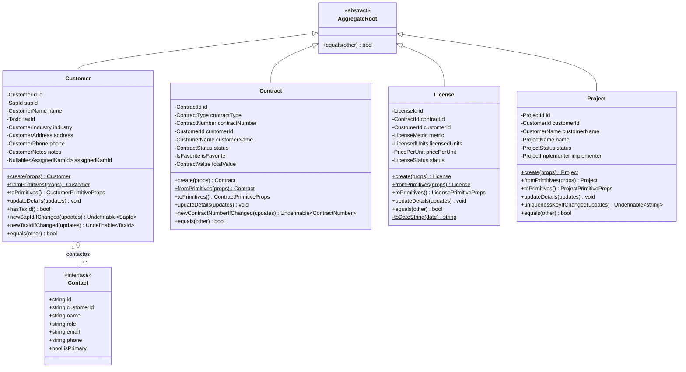
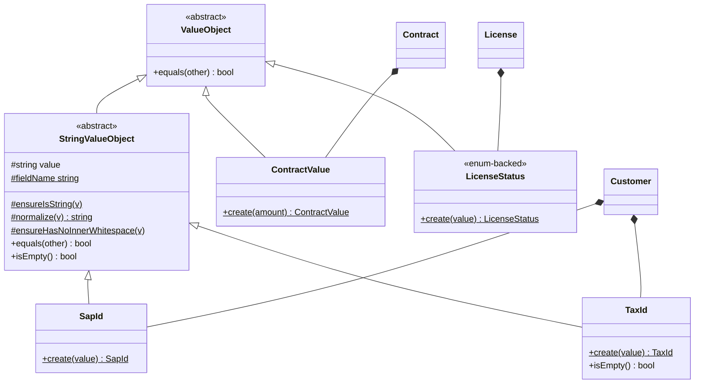
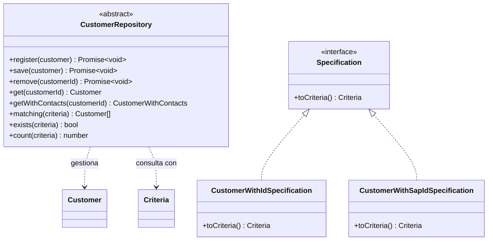

# UML de clases — Dominio de `sap-licences`

**Fecha:** 2026-07-10
**Origen:** extraído y verificado de la capa `domain/` real (agregados, value-objects, puertos). Incluye **atributos y métodos**.
**Nota:** el diagrama ER anterior (`uml-modelo-dominio.md`) modela la persistencia (tablas + FKs). Este modela el **comportamiento** del dominio: es el UML de clases propiamente dicho. Ambos son útiles y describen cosas distintas.

---

## 1. Agregados (raíces + comportamiento)

Observa el **protocolo común** que comparten los cuatro agregados: `create()` (fábrica con invariantes), `fromPrimitives()` / `toPrimitives()` (rehidratación y serialización), `updateDetails()` (mutación controlada campo a campo) y `equals()`. Ese protocolo es idéntico entre vistas → es plantilla **estructural**. Lo que cambia es la lista de atributos-VO y los métodos de unicidad específicos (`newSapIdIfChanged`, `newContractNumberIfChanged`, `uniquenessKeyIfChanged`) → eso es **binding**.

`Contact` es una `interface`, no un agregado: es una entidad interna del agregado `Customer` sin comportamiento propio.

---

## 2. Value Objects (jerarquía + comportamiento)

Cada campo del dominio está encapsulado en un VO con `private constructor` + `static create()` que valida invariantes. Esto es puro DDD y es donde vive la validación.

Ejemplo real (`SapId`): `create()` normaliza, prohíbe whitespace interno y valida longitud mínima/máxima, lanzando `CustomerError` si falla. Cada VO es una unidad de validación autocontenida.

---

## 3. Puertos del dominio (repositorio + especificaciones)

El dominio define **interfaces** (puertos); la infraestructura las implementa. El repositorio habla el lenguaje de `Criteria` del esqueleto.

El patrón se repite por módulo: `ContractRepository`, `LicenseRepository`, `ProjectRepository`, cada uno con `matching(criteria)`, `exists`, `count` + operaciones propias (p.ej. `LicenseRepository.getWith...`). Las **specifications** encapsulan consultas nombradas (buscar por id, por sapId, por taxId…) y las traducen a `Criteria`.

---

## 4. Qué es estructura y qué es binding (para el generador/RAG)

| Elemento del UML | Clasificación | Por qué |
|---|---|---|
| Protocolo `create/fromPrimitives/toPrimitives/updateDetails/equals` | **Estructura** | Idéntico en los 4 agregados; se copia tal cual |
| Herencia de `AggregateRoot` / `StringValueObject` | **Estructura** | Base del esqueleto |
| Interfaz de repositorio (`matching/exists/count/get/save…`) | **Estructura** | Firma común; solo cambia el tipo de agregado |
| Lista de atributos-VO de cada agregado | **Binding** | Deriva de la entidad concreta |
| VOs concretos y sus reglas de `create()` | **Binding** | Validación específica del campo |
| Métodos de unicidad (`newSapIdIfChanged`, `uniquenessKeyIfChanged`) | **Binding** | Dependen de qué campos son únicos |
| Specifications concretas | **Binding** | Consultas propias del dominio |

Esto refina el "hueco de binding" del contrato de unidad-vista: no basta con generar la entidad TypeORM y `columns[]`; hay que generar también **el agregado con su protocolo, sus VOs y sus specifications**. El comportamiento (los métodos) es justo lo que el diagrama ER no capturaba y por lo que un UML de clases es imprescindible aquí.

---

## 5. Conclusión

El UML de clases muestra que el dominio tiene un **esqueleto de comportamiento muy regular** (el protocolo de agregado + la jerarquía de VOs + la interfaz de repositorio) sobre el que cada módulo añade su lista de VOs y sus reglas de validación/unicidad. Es exactamente la misma dualidad estructura/binding que en las vistas, ahora en el dominio: el generador puede plantillar el 80% (el protocolo) y derivar del modelo el 20% específico (los VOs y sus invariantes). Esto encaja el dominio en la misma cadena: **UML de clases + ER → resource-schema → generador → módulo completo (dominio + persistencia + vista)**.
