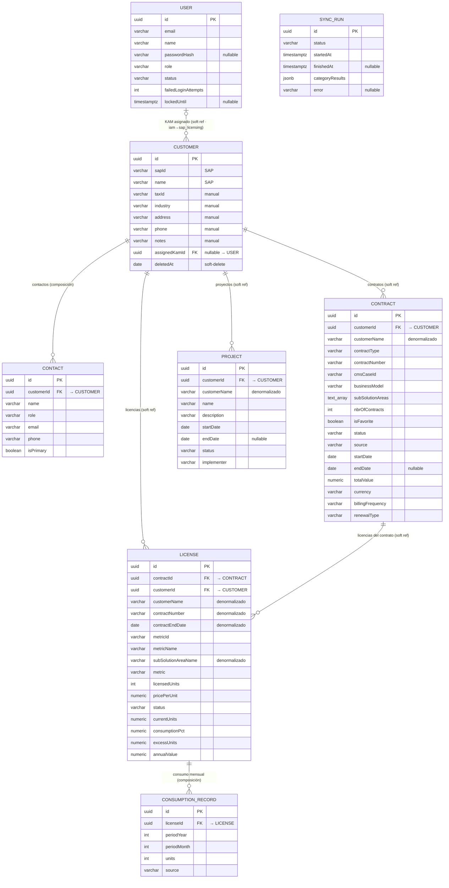
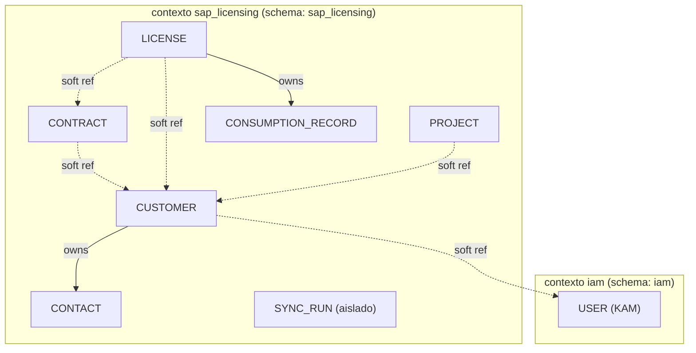
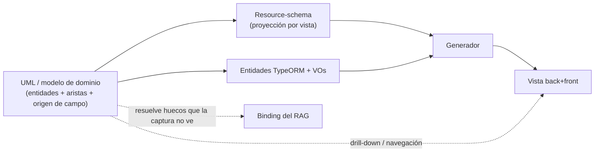

# UML — Modelo de dominio de `sap-licences`

**Fecha:** 2026-07-10
**Origen:** extraído y verificado de las entidades TypeORM reales del backend (no inventado).
**Rol en el acelerador:** este es el **single-source-of-truth** del que derivan los resource-schemas (proyecciones por vista) y, a través de ellos, el generador y el binding del RAG. A nivel de usuario cada vista es una tabla aislada; este diagrama es el grafo que hay por debajo.

---

## 1. Diagrama entidad-relación

> `SYNC_RUN` es un agregado independiente (log de sincronización con SAP): no participa en el grafo de negocio, por eso aparece suelto.

---

## 2. Los dos tipos de arista (clave para el generador)

El backend **no usa relaciones TypeORM** (`@ManyToOne`/`@OneToMany`): todas las conexiones son **referencias por ID**, como manda DDD para no acoplar agregados. Pero no todas las aristas son iguales, y el generador debe tratarlas distinto:

### Composición (agregado propietario)

El hijo pertenece al padre, comparte ciclo de vida y vive en el mismo módulo.

| Padre → Hijo | Módulo | Implicación para el generador |
|---|---|---|
| CUSTOMER → CONTACT | `customers` | Se crea/borra con el cliente. Cascada. UI: sub-tabla dentro de la ficha de cliente. |
| LICENSE → CONSUMPTION_RECORD | `licenses` | Histórico de consumo propio de la licencia. |

### Referencia entre contextos (soft reference)

Solo se guarda el ID; no hay FK dura porque cruza límites de contexto/agregado. Se resuelve con un lookup en la aplicación.

| Origen → Destino | Cruza | Implicación para el generador |
|---|---|---|
| CUSTOMER.assignedKamId → USER | `sap_licensing` → `iam` | Solo ID + lookup. Nunca join duro entre esquemas. |
| CONTRACT.customerId → CUSTOMER | módulos hermanos | ID + drill-down. Detalle de cliente lista sus contratos. |
| LICENSE.customerId / contractId → CUSTOMER / CONTRACT | módulos hermanos | Doble referencia. Drill-down desde cliente y desde contrato. |
| PROJECT.customerId → CUSTOMER | módulos hermanos | ID + drill-down. |

Línea sólida = composición (cascada, misma frontera). Línea discontinua = referencia blanda (solo ID + lookup, cruza fronteras).

---

## 3. Observaciones que el modelo revela

**Denormalización deliberada.** `customerName` se repite en CONTRACT, LICENSE y PROJECT; LICENSE además copia `contractNumber`, `contractEndDate` y `subSolutionAreaName`. Son copias de lectura escritas en el momento de sincronizar, para que cada tabla se pinte sin joins. El generador debe saber que esos campos **no son datos propios**: se derivan de la entidad relacionada y se congelan. (Trade-off clásico: velocidad de lectura vs. riesgo de desincronización si la fuente cambia.)

**Soft-delete transversal.** Casi todas las entidades tienen `deletedAt`. Es una convención del esqueleto (borrado lógico), no del dominio de cada vista → pertenece a la plantilla estructural, no al binding.

**SAP vs. manual.** En CUSTOMER, solo `sapId` y `name` vienen de SAP; `taxId`, `industry`, `address`, `phone`, `notes`, `assignedKamId` son de entrada manual (coincide con el hallazgo documentado: SAP no expone un endpoint de clientes). El resource-schema debe marcar el origen de cada campo, porque cambia si es editable en formulario o read-only.

**Todo cuelga de CUSTOMER.** El grafo tiene una raíz clara: el cliente. Es el eje de navegación natural (ficha de cliente → sus contratos, licencias, proyectos, contactos) y el candidato natural a discriminador multi-tenant si algún día el acelerador sirve a varias organizaciones.

---

## 4. Cómo alimenta al resto del acelerador

En concreto, del UML se derivan:

- **Entidades TypeORM + value-objects** (los ficheros `[BINDING]` del contrato de unidad-vista).
- **`search-*-config.ts`**: los campos filtrables/ordenables/buscables salen de los atributos de la entidad.
- **`columns[]` del front**: idem, con el `origen` marcando cuáles son editables.
- **Navegación / drill-down**: cada arista de referencia se convierte en un enlace entre vistas (ficha de cliente → tabla de sus contratos filtrada por `customerId`).
- **Los "huecos de binding" del RAG**: exactamente lo que una captura no puede mostrar (que esta tabla de licencias enlaza con contrato y cliente) lo aporta el grafo.

---

## 5. Conclusión

El modelo confirma la intuición de partida: **las vistas parecen datos sueltos pero comparten un grafo con raíz en CUSTOMER**, referenciado por ID (no por FK dura) siguiendo DDD. Formalizarlo como UML da al acelerador la pieza que faltaba — sin él, cada vista generada sería una isla incapaz de enlazar, y el RAG no podría reponer las conexiones que la imagen no ve. Con él, el orden de construcción queda cerrado: **UML → resource-schema (proyección) → generador → vista**, y el RAG como puerta de autoría por encima.
